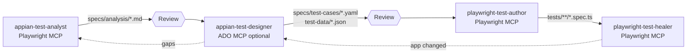

# Appian E2E test automation – Copilot agent team (v0.3 – for review)

Four GitHub Copilot custom agents that take an Appian process from **exploration → analysis →
data-driven test cases → Playwright tests → stable suite**, with a human review gate between stages.



## What's new in v0.3

| Change | Why |
|---|---|
| Agents use the **`playwright-test` MCP server** (`npx playwright run-test-mcp-server`) | gives `*_setup_page`, `generator_read_log` (recorded locators), `browser_verify_*`, `test_run` / `test_debug` |
| **Seed tests per role** (`tests/seeds/seed.<role>.spec.ts`, project `seed`) | agents start already logged in – credentials never reach the agent or chat |
| Author executes steps live, checks every expectation with `browser_verify_*`, translates the generator log into page objects | no invented locators or assertions |
| Healer uses `test_debug` (paused at the failing step), **max 3 fix attempts**, then `test.fixme()` + defect note | no endless loops, defects are reported instead of hidden |
| **Traceability header** in every spec (`analysis`, `testCases`, `data`, `seed`) | healer/designer find the source of any failing test |
| Shared rules → **`AGENTS.md`**; Appian know-how → **`appian-playwright` skill** | no rules copied 4×; also applies to ad-hoc chats and Playwright's official agents |
| `npm run agents:drift` | after a Playwright upgrade: checks our tools still exist and lists new tools in official agents |
| `model:` per agent, `.github/workflows/copilot-setup-steps.yml` | model pinning; sandbox setup if you run agents on GitHub.com |

Deliberately **not** used from the official agents: `browser_run_code_unsafe` (arbitrary code execution),
`generator_write_test` (writes raw single-file tests – we need page objects + data-driven specs),
`planner_save_plan` (fixed plan format – the analyst uses `specs/analysis/_TEMPLATE.md`).

## Agents

| Agent | Reads | Writes | Never does |
|---|---|---|---|
| `appian-test-analyst` | live app (MCP) | `specs/analysis/<scope>.md` | test cases, code |
| `appian-test-designer` | analysis | `specs/test-cases/<scope>.yaml`, `test-data/<scope>.json`, ADO Test Cases | browser, code |
| `playwright-test-author` | test cases + data, live app | page objects, fixtures, specs | change expectations |
| `playwright-test-healer` | test results, traces, live app | minimal fixes / defect reports | loosen assertions, add retries |

Each agent ends with **handoff buttons** to the next (or previous) agent – nothing chains automatically.

## Prompt library (`.github/prompts/`) – 5 per agent

In Copilot Chat type `/` and pick one; each opens the right agent and asks for its inputs.

| Analyst | Designer | Author | Healer |
|---|---|---|---|
| `/analyst-map-app-scopes` | `/designer-design-from-analysis` | `/author-automate-test-case-file` | `/healer-heal-failing-spec` |
| `/analyst-analyze-process` | `/designer-design-boundary-data` | `/author-automate-single-test-case` | `/healer-heal-ci-run` |
| `/analyst-analyze-form-validations` | `/designer-design-negative-cases` | `/author-automate-free-text-scenario` | `/healer-hunt-flaky-tests` |
| `/analyst-analyze-roles-security` | `/designer-sync-to-azure-devops` | `/author-create-page-object` | `/healer-heal-after-appian-upgrade` |
| `/analyst-update-analysis-after-change` | `/designer-review-coverage` | `/author-extend-appian-components` | `/healer-triage-defect` |

Typical day: `/analyst-map-app-scopes` once → per scope `/analyst-analyze-process` → review →
`/designer-design-from-analysis` → review → `/author-automate-test-case-file` → `/healer-heal-failing-spec`.

## Framework

```
AGENTS.md                  # rules for every agent (structure, commands, hard rules)
.github/skills/appian-playwright/  # skill: component catalog, log→POM translation, spec pattern
tests/seeds/seed.<role>.spec.ts    # agent entry points, logged in per role (project "seed")
scripts/check-agent-drift.mjs      # npm run agents:drift
src/appian/components.ts   # label-based Appian helpers (textField, dropdown, dateField, radio,
                           # checkbox, button, link, grid, section, validations, waitForIdle)
src/appian/api.ts          # Appian Web API client for test-data setup/cleanup (example endpoints)
src/data/loadData.ts       # data sets + placeholders {{uniqueId}}, {{today±N}}
src/pages/AppianPage.ts    # base page object (this.ui = AppianComponents)
src/pages/AppianLoginPage.ts
src/pages/expense/NewExpenseForm.ts   # EXAMPLE page object
src/fixtures/index.ts      # page objects, appEnv, appianApi, asRole('approver')
tests/auth/auth.setup.ts   # one saved session per role in APPIAN_ROLES
tests/expense/submit-expense.spec.ts  # EXAMPLE data-driven spec (from _TEMPLATE.yaml)
specs/analysis/_TEMPLATE.md
specs/test-cases/_TEMPLATE.yaml + test-cases.schema.json
test-data/submit-expense.json
```

## Setup

```bash
npm install
npx playwright install --with-deps chromium
cp .env.example .env     # fill BASE_URL, roles and credentials
npm run typecheck
npm run validate        # offline: YAML schema, data sets, traceability headers
npm test                 # npm run test:smoke | test:data | report
```

MCP servers (`.vscode/mcp.json`): `playwright-test` (Playwright test MCP) and `ado` (Azure DevOps – asks for your org name).
New role? Add it to `APPIAN_ROLES` + credentials, and copy a seed file to `tests/seeds/seed.<role>.spec.ts`.

After every Playwright upgrade: `npm run agents:drift`.

## First things to do on your Appian environment

1. Run `/author-extend-appian-components` (or ask the author agent) to **verify every helper marked
   `VERIFY` in `src/appian/components.ts`** against your Appian version – especially dropdown,
   date field, section and the busy indicator used by `waitForIdle()`.
2. Check the login page labels (`Username`, `Password`, `Sign In`) – adjust if you use SSO.
3. Replace the example expense page object, spec, data and API endpoints with your first real scope.

## CI

`.github/workflows/validate.yml` (GitHub Actions) runs on every PR without an Appian environment:
type-check, `npm run validate`, test discovery (`playwright test --list`) and `npm run agents:drift`.

`azure-pipelines.yml` maps the variable group `e2e-secrets` (`BASE_URL`, `APPIAN_ROLES`,
`APPIAN_<ROLE>_USERNAME/PASSWORD`, `APPIAN_DATE_FORMAT`, `APPIAN_API_KEY`) into the test step and
publishes JUnit results + the HTML report. Add more roles = add variables + extend the `env:` mapping.
